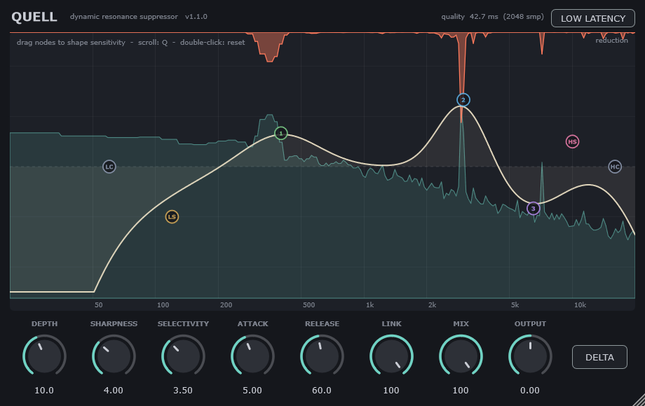

# Quell 1.1.0 — dynamic resonance suppressor

An original, soothe-style spectral processor: it finds narrow resonances that stick out of the
spectrum and turns them down dynamically, only while they are happening.

**Windows** (VST3, standalone) and **macOS** (VST3, AU, standalone; universal binary, native on Apple Silicon M1–M4).



Not affiliated with oeksound. No code or assets from soothe are used. This is an independent implementation of the general technique.

## Install

**Windows 10/11 (64-bit):** unzip `Quell-1.1.0-Windows-x64.zip`. Copy `Quell.vst3` (the whole folder) to `C:\Program Files\Common Files\VST3\` and rescan plugins in your DAW. No VC++ redistributable is needed.

**macOS 11+ (Apple Silicon or Intel):** unzip `Quell-1.1.0-macOS-Universal.zip`.
- Copy `Quell.vst3` to `~/Library/Audio/Plug-Ins/VST3/`.
- Copy `Quell.component` (AU, for Logic and GarageBand) to `~/Library/Audio/Plug-Ins/Components/`.
- The build is ad-hoc signed but not notarized, so remove the download quarantine once:

```
xattr -dr com.apple.quarantine ~/Library/Audio/Plug-Ins/VST3/Quell.vst3 ~/Library/Audio/Plug-Ins/Components/Quell.component
```

## How it works

STFT analysis (2048-point at 44.1/48 kHz, 4096 at 88.2/96 kHz, 75% overlap). Every ~11 ms:

1. Per-bin level is measured. The power is lightly smoothed across neighbouring bins and over about 20 ms, so random noise isn't treated as resonance.
2. A smooth "expected" spectrum is estimated by averaging in dB over a log-frequency window. This is done twice, the second time with peaks clipped, so resonances don't drag the envelope up.
3. Energy above the envelope (minus the Selectivity threshold) goes through a soft-knee curve that saturates at Depth. The sensitivity EQ scales depth and shifts the threshold per frequency.
4. Reduction is linked across channels, blurred slightly across frequency, then smoothed with Attack/Release.
5. The gains are applied. How depends on the mode (below).

## Quality vs. low latency

The **LOW LATENCY** button (top right) switches modes. The header shows the current latency.

| Mode | Latency | How gains are applied | Trade-off |
|---|---|---|---|
| Quality (default) | 42.7 ms at 48 kHz (one 2048 frame) | Multiplied into the STFT and resynthesised | Reduction is perfectly time-aligned with the audio it analysed |
| Low latency | **0 ms** | Turned into a minimum-phase FIR filter (1024 taps at 48 kHz) that filters the live signal. A new filter is crossfaded in every ~5 ms | Reduction reacts a few ms after a resonance starts (no look-ahead). Slightly more CPU |

Low-latency mode keeps the same frequency resolution, so notches stay narrow. Minimum-phase means no pre-ringing and the least possible delay. Use it for tracking and live monitoring, and Quality for mixing.

Switching modes fades the output out and back in, with a brief dropout. The host is told the new latency right away. Some DAWs only re-apply delay compensation after playback is stopped and restarted. The setting is saved with the session and isn't automatable.

CPU, measured on the Windows build machine: Quality 1.4% / 2.7% and Low latency 5.4% / 13.9% of one core, at 48 / 96 kHz stereo.

## Controls

| Control | Range | What it does |
|---|---|---|
| Depth | 0–24 dB | Maximum reduction per bin |
| Sharpness | 1–10 | Higher = narrower notches; only very narrow peaks are treated |
| Selectivity | 0–10 | Higher = a peak must stand out more before it's touched |
| Attack / Release | 0.5–200 / 5–1000 ms | How fast reduction engages and recovers |
| Link | 0–100 % | Stereo link of the reduction |
| Mix | 0–100 % | Dry/wet |
| Output | ±24 dB | Output trim |
| Delta | on/off | Hear only what's being removed |
| Low Latency | on/off | 0 ms instead of 42.7 ms (see above) |

## Sensitivity EQ

The display has an EQ-style curve that controls **where** Quell works. It doesn't EQ the audio.

| Node | Controls |
|---|---|
| LC / HC | Low / high cut. Processing fades out beyond them. Parked at the edges = off |
| LS / HS | Low / high shelf, ±12 dB sensitivity |
| 1, 2, 3 | Bells, ±12 dB sensitivity, Q 0.3–8 |

- Drag a node: left/right sets frequency, up/down sets sensitivity.
- Scroll over a bell: changes Q.
- Double-click: resets the node.

Raising the curve makes Quell more aggressive there: more depth and a lower detection threshold. +6 dB doubles the depth. Lowering it makes Quell gentler. Every node is a regular automatable parameter.

## Building

The version number lives in `CMakeLists.txt` (`project(Quell VERSION ...)`). JUCE 9.0.4 is downloaded automatically, or pass `-DJUCE_DIR=path/to/JUCE`.

**Windows** — needs Visual Studio 2022/2026 or Build Tools with C++, plus Git:

```
scripts\build-windows.bat
```

It builds in `C:\qb` (override with the `QUELL_BUILD` environment variable), runs the tests, and writes `dist\Quell-<version>-Windows-x64.zip`. Keep the build directory on a short path; the Windows resource compiler fails on very long paths.

**macOS** — needs Xcode command line tools (`xcode-select --install`) and CMake (`brew install cmake`):

```
./scripts/build-macos.sh            # build + test + package
./scripts/build-macos.sh --install  # also installs VST3/AU and runs auval
```

It writes `dist/Quell-<version>-macOS-Universal.zip` (arm64 + x86_64).

**GitHub Actions** — [.github/workflows/build.yml](.github/workflows/build.yml) builds both platforms on every push.
- It runs the tests, checks the Mac binary contains both architectures, ad-hoc signs it, and validates the AU with `auval`.
- Zips are uploaded as artifacts.
- Pushing a tag like `v1.1.0` also attaches them to a GitHub release.

### Tests

`QuellEngineTest` checks:
- The plugin nulls at depth 0.
- It cuts a resonance over noise by >6 dB without dulling white noise (<1.5 dB).
- Wet + delta = dry.
- The sensitivity curve steers processing.
- Low-latency mode at 48 and 96 kHz: ≤1 ms latency (it's 0), bit-identical at depth 0, resonance cut, noise untouched, a minimum-phase filter, exact delta.
- CPU stays under 25% of a core.

`-DQUELL_BUILD_SNAPSHOT=ON` builds `QuellSnapshot out.png`. It renders the editor to an image and checks that switching modes mid-stream reports the right latency without glitches.

### Distribution notes (macOS)

Builds are ad-hoc signed. To ship without the quarantine step, sign with an Apple Developer ID (`codesign --options runtime --timestamp -s "Developer ID Application: ..."`) and notarize with `xcrun notarytool`.
